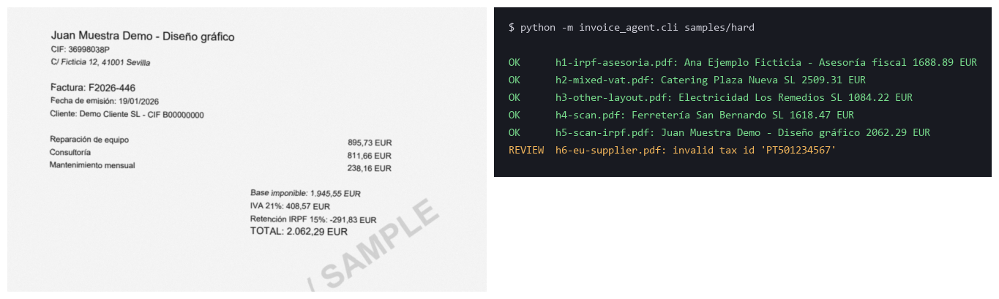

# invoice-agent

An AI agent that reads supplier invoices from an email inbox, extracts the accounting fields with an LLM, and **checks them with deterministic rules before anything reaches the ledger**. Invoices that don't add up go to a human-review queue with the reason, instead of being recorded blindly.

Built for the everyday problem of a small business: PDFs arrive by email and someone types supplier, tax ID and amounts into a spreadsheet by hand.



## How it works

```
Email (IMAP) ──► PDF attachments ──► text layer?  yes → text
                                                  no  → page images (scans)
                                          │
                                          ▼
                         LLM extracts fields as JSON
                (supplier, tax ID, number, date, base, VAT, IRPF, total, currency)
                                          │
                                          ▼
                    Deterministic checks — no AI involved
                     all pass                  any fails
                        │                          │
                        ▼                          ▼
                 Ledger (SQLite + CSV)     Review queue (+ reason)
```

| Module | Role |
|---|---|
| `invoice_agent/mail.py` | Downloads PDF attachments from matching emails over IMAP |
| `invoice_agent/extract.py` | PDF text extraction; renders pages to images when there is no text layer |
| `invoice_agent/llm.py` | Field extraction through any OpenAI-compatible endpoint (DeepSeek by default), text or vision |
| `invoice_agent/validate.py` | Independent checks that decide ledger vs. review |
| `invoice_agent/store.py` | SQLite ledger and review queue, CSV export, idempotent re-runs |
| `invoice_agent/cli.py` | Wires it together; one failing file never stops the batch |

### Validation rules

The LLM can be wrong, so every invoice must pass all of these to be recorded:

- `base + VAT − withholding = total` (Spanish IRPF retention supported)
- VAT and withholding match their stated rates (skipped when an invoice mixes VAT rates)
- Spanish NIF / NIE / CIF control character is valid
- Not a duplicate (same supplier tax ID and invoice number)
- Date is valid and not in the future; no required field missing

## Quickstart (no email account needed)

```bash
python -m venv .venv && .venv/Scripts/activate      # Windows; use bin/activate elsewhere
pip install -r requirements.txt
cp .env.example .env                                # add your LLM API key
python samples/generate.py                          # synthetic invoices + ground truth
python -m invoice_agent.cli samples/hard --out output/hard
python samples/evaluate.py hard                     # compare against ground truth
```

Results land in `output/<set>/invoices.db` and `invoices.csv`.

## Reading from an inbox

```bash
python -m invoice_agent.cli inbox/ --imap
```

With Gmail, enable 2-Step Verification and create an [app password](https://myaccount.google.com/apppasswords), then fill the `IMAP_*` variables.

By default the agent only reads **unread emails with "factura" in the subject**, opens them without marking them read, and marks as read **only those that carry a PDF**. The rest of the mailbox is left untouched, which matters when the inbox is a shared, busy one.

### Configuration

| Variable | Default | Purpose |
|---|---|---|
| `DEEPSEEK_API_KEY` / `LLM_API_KEY` | — | API key (`LLM_API_KEY` wins if both are set) |
| `LLM_BASE_URL` | `https://api.deepseek.com` | Any OpenAI-compatible endpoint |
| `LLM_MODEL` | `deepseek-flash` | Must support images for scanned invoices |
| `IMAP_HOST`, `IMAP_USER`, `IMAP_PASSWORD` | — | Mailbox access |
| `IMAP_FOLDER` | `INBOX` | Folder to read |
| `IMAP_SEARCH` | `(UNSEEN SUBJECT "factura")` | IMAP search criteria |

## Evaluation

`samples/generate.py` creates fictitious invoices (stamped *MUESTRA FICTICIA / SAMPLE*) with known ground truth:

- **clean** — 10 template invoices plus 3 that must be rejected: wrong total, invalid CIF, duplicate.
- **hard** — IRPF withholding, mixed VAT rates, a different layout, two scanned (image-only) PDFs, and an EU supplier.

Results with `deepseek-flash` on 2026-11-01 (identical across the repeated runs after the prompt change):

| Set | Fields exactly right | Routed correctly (ledger / review) |
|---|---|---|
| clean (13) | 13/13 | 13/13 |
| hard (6) | 6/6 | 6/6 |

Read these numbers for what they are: synthetic data from one generator, and the prompt was adjusted once (currency) after the first run on these same sets. They show the pipeline works end to end; they are not an accuracy estimate for real-world invoices. The IMAP path was also tested end to end with real emails sent to a Gmail test inbox.

Cost: the whole evaluation stayed under one US cent.

## Limitations

- Only Spanish tax IDs are validated, so foreign suppliers always go to review (by design, not a bug).
- Emails without "factura" in the subject are ignored unless `IMAP_SEARCH` is changed.
- Gmail may file invoice emails from new senders as spam; one of the test emails landed there.
- Scanned invoices require a vision-capable model.
- Only tested with DeepSeek; other OpenAI-compatible endpoints should work through `LLM_BASE_URL` but are untested.

## Tests

```bash
pytest
```

Unit tests cover the validation rules and attachment parsing (including RFC 2047-encoded filenames) and need no API key.

---

Built with [Claude Code](https://claude.com/claude-code).
